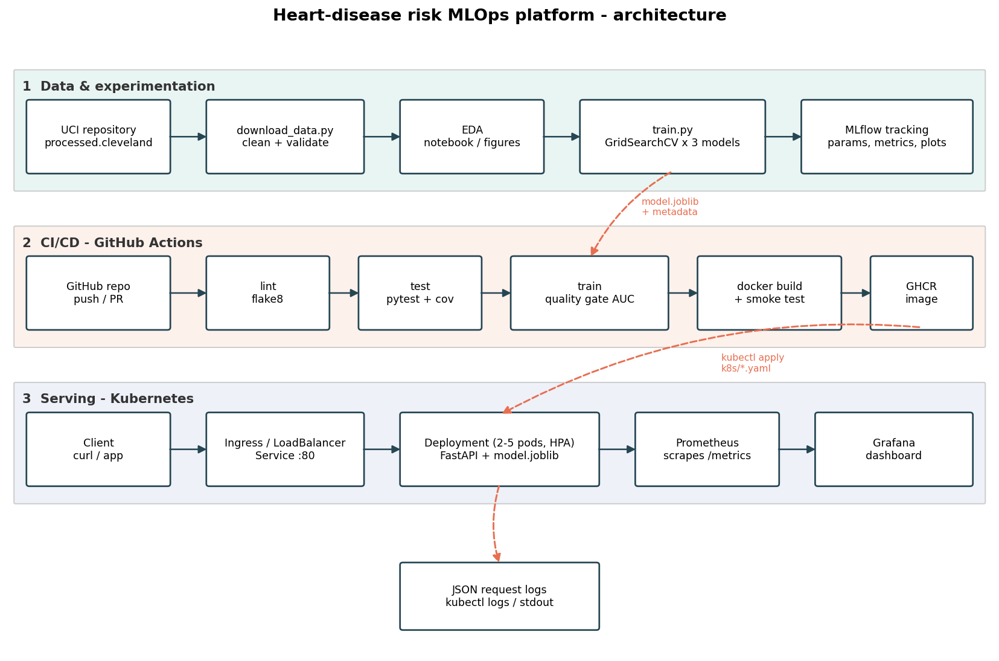

# Heart-Disease Risk Prediction: End-to-End MLOps

This project predicts heart-disease risk from 13 clinical attributes (UCI Heart Disease,
Cleveland subset). It has reproducible training with MLflow tracking, a tested FastAPI service,
a Docker image, Kubernetes manifests, Prometheus and Grafana monitoring, and a GitHub Actions
CI/CD pipeline.



## Repository layout

| Path | Purpose |
|---|---|
| `scripts/download_data.py` | Downloads the raw data from UCI (with a fallback mirror) and writes `data/processed/heart_clean.csv` |
| `scripts/smoke_test.py` | Checks a running API with sample patients (`scripts/sample_input.json`); used locally and in CI |
| `src/heart_risk/` | Library code: `data.py` (load and clean), `features.py` (feature engineering and preprocessing pipeline), `eda.py`, `train.py` (GridSearchCV and MLflow), `predict.py` |
| `api/` | FastAPI app (`/predict`, `/predict/batch`, `/health`, `/ready`, `/model-info`, `/metrics`) |
| `notebooks/` | Executed notebooks: 01 EDA, 02 training and tracking, 03 inference |
| `tests/` | Pytest suite for data, features, model and API (self-contained, synthetic data) |
| `models/` | Exported champion pipeline `model.joblib` plus `metadata.json` |
| `reports/` | EDA figures, training plots, `model_comparison.csv` |
| `Dockerfile`, `docker-compose.yml` | Serving image; local stack with Prometheus and Grafana |
| `k8s/` | Namespace, ConfigMap, Deployment, LoadBalancer Service, Ingress, HPA, `monitoring/` |
| `monitoring/` | Prometheus config, Grafana datasource and dashboard provisioning |
| `.github/workflows/ci.yml` | lint, then test, then train (with quality gate), then docker build, smoke test and push |
| `report/` | Final project report (PDF) |
| `screenshots/` | Evidence screenshots: MLflow, CI/CD, Docker, Kubernetes, monitoring |

## 1. Setup (clean environment)

```bash
git clone https://github.com/arjunpm97/heart-risk-mlops
cd heart-risk-mlops
python -m venv .venv
# Windows: .venv\Scripts\activate      Linux/macOS: source .venv/bin/activate
pip install -r requirements.txt
pip install -e .
```

Python 3.13 is recommended (3.10 to 3.13 work). The versions are pinned, and the serving image uses the same
scikit-learn and numpy versions.

## 2. Data, EDA and training

```bash
python scripts/download_data.py          # data/raw + data/processed/heart_clean.csv
python -m heart_risk.eda                 # reports/figures/*.png
python -m heart_risk.train               # 3 model families, 82 tuned candidates, MLflow runs
mlflow ui --backend-store-uri ./mlruns --port 5001   # http://127.0.0.1:5001
```

The notebooks in `notebooks/` (EDA, training and tracking, inference) can be re-run in Jupyter or
VS Code with **Run All**.

`train.py` logs one parent run per model family and one nested run per hyperparameter
combination, and exports the champion to `models/model.joblib`. The file is a complete sklearn
`Pipeline` (feature engineering, imputation, scaling and encoding, then the model), so it
accepts raw patient JSON.

The champion is picked by a stability-penalised score (mean CV ROC-AUC minus its standard
deviation). Its decision threshold is then tuned on out-of-fold predictions for at least 90%
recall, because missing a sick patient is worse than a false alarm.

Current champion: **Logistic Regression** (C=0.5, L2, balanced). CV ROC-AUC 0.908 ± 0.017;
hold-out test ROC-AUC 0.961. At the tuned threshold of 0.302, test recall is 0.964 and
precision 0.711 (at 0.5 they are 0.929 and 0.812). The API also returns a `risk_band`
(low / moderate / high).

## 3. Tests and lint

```bash
flake8 src api tests scripts
pytest -v --cov=heart_risk --cov=api
```

## 4. Run the API

```bash
uvicorn api.main:app --port 8000          # local
# or in Docker
docker build -t heart-risk-api:1.0.0 .
docker run -p 8000:8000 heart-risk-api:1.0.0
python scripts/smoke_test.py --url http://localhost:8000
```

Sample request:

```bash
curl -X POST http://localhost:8000/predict -H "Content-Type: application/json" \
  -d '{"age":63,"sex":1,"cp":1,"trestbps":145,"chol":233,"fbs":1,"restecg":2,"thalach":150,"exang":0,"oldpeak":2.3,"slope":3,"ca":0,"thal":6}'
# {"prediction":0,"label":"no_heart_disease","confidence":0.702,"risk_probability":0.298,"risk_band":"low",
#  "model_version":"logistic_regression-1.0.0","request_id":"..."}
```

You can also open http://localhost:8000/docs and use **Try it out**.

## 5. Monitoring stack (Docker Compose)

```bash
docker compose up --build -d
python scripts/smoke_test.py --url http://localhost:8000 --load 300   # generate traffic
```

* API: http://localhost:8000/docs
* Prometheus: http://localhost:9090 (Status → Targets)
* Grafana: http://localhost:3000 (admin/admin). Open the dashboard *MLOps → Heart Risk API*.

Each request is logged as one JSON line: request id, path, status, latency, and the
prediction with its inputs. Use `docker logs heart-risk-api` or `kubectl logs` to read them.

## 6. Kubernetes deployment (Docker Desktop or Minikube)

Enable Kubernetes in Docker Desktop (Settings → Kubernetes, cluster type kubeadm), then:

```bash
docker build -t heart-risk-api:1.0.0 .
kubectl apply -f k8s/00-namespace.yaml
kubectl apply -f k8s/
kubectl -n heart-risk create configmap grafana-dashboards \
  --from-file=monitoring/grafana/dashboards/heart_risk_dashboard.json \
  --dry-run=client -o yaml | kubectl apply -f -
kubectl apply -f k8s/monitoring/
kubectl -n heart-risk rollout status deployment/heart-risk-api --timeout=180s
```

With Minikube instead, run `eval $(minikube docker-env)` before `docker build`, and
`minikube tunnel` in a separate terminal to expose the LoadBalancer.

Verify:

```bash
kubectl -n heart-risk get pods,svc,ingress,hpa
python scripts/smoke_test.py --url http://localhost            # LoadBalancer
# Ingress: add "127.0.0.1 heart-risk.local" to the hosts file, then http://heart-risk.local/docs
kubectl -n heart-risk port-forward svc/grafana 3000:3000
```

For a cloud cluster (GKE, EKS or AKS), CI pushes `ghcr.io/arjunpm97/heart-risk-api:latest` on every
push to `main`. Change `image:` in `k8s/02-deployment.yaml` to that tag and run
`kubectl apply -f k8s/`. The `LoadBalancer` Service then gets a public IP.

## 7. CI/CD

`.github/workflows/ci.yml` runs on every push and PR:

1. **lint**: flake8. The pipeline fails on any style or syntax error.
2. **test**: pytest with JUnit XML and coverage, uploaded as artifacts.
3. **train**: downloads the data, runs EDA and training, writes a model-comparison table to the
   run's summary page, and applies a quality gate (test ROC-AUC ≥ 0.85 and recall at the tuned
   threshold ≥ 0.85). It uploads `models/`, `reports/`, `mlruns/` and the training log.
4. **docker**: builds the image, runs the container, and smoke-tests `/predict` and `/metrics`.
   It uploads the container logs and pushes to GHCR on `main`.

Each job depends on the previous one, so any failure stops the pipeline with clear logs.

## 8. Report and Video

The final report is in `report/MLOps_Assignment_Report.pdf`. It covers setup, EDA and modelling choices, the experiment
tracking summary, the architecture, and the CI/CD, deployment and monitoring evidence from
`screenshots/`.

Video walkthrough of the pipeline: https://drive.google.com/file/d/13LKzNS0Wq5nVIOyBUQhqACICXFJaL9Uy/view?usp=sharing 
